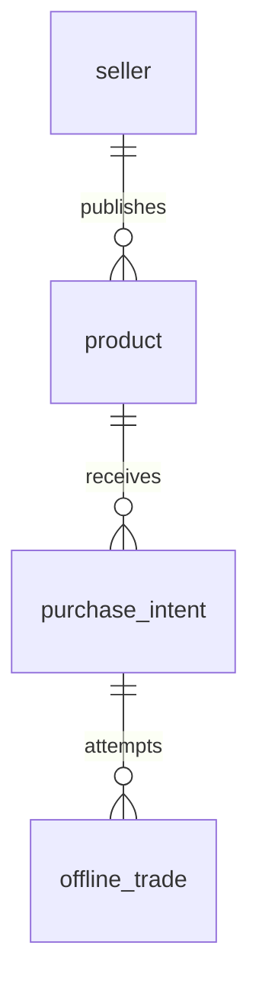

# 数据库技术方案（孙俊杰负责）

## 1. 范围与口令码约定
实现单卖家、一次一件在售商品、免注册购买意向、线下交易、冻结/成功下架/失败恢复、商品历史及后台修改密码。
不设计在线支付、购物车、多卖家与用户注册。
新增口令码定义为买家购买意向的查询与线下核对凭证；这是一项设计假设，如课程要求的是店铺访问口令，需要调整。

## 2. 技术与安装
使用 MySQL 8.0.16+，InnoDB、utf8mb4。SQL 文件： [schema.sql](https://github.com/sjj124390/-/blob/main/database/schema.sql)。
首次在空环境运行：
```bash
mysql -u root -p < database/schema.sql
```
脚本不删除已有数据；重复执行会在同名表处报错。建库完成不等于应用已部署，前后端仍需对接。
后端初始化唯一卖家 id=1，password_hash 使用 BCrypt/Argon2 结果，通过参数绑定写入；不提交明文密码。
```sql
INSERT INTO seller(id,username,password_hash) VALUES(1, ?, ?);
INSERT INTO product(name,description,image_url,price)
VALUES(?, ?, ?, ?);
CALL publish_product(?);
```
问号是 JDBC PreparedStatement/CallableStatement 参数，不是可直接粘贴到 MySQL 的字面量。

## 3. 表结构
| 表 | 用途 | 主要字段与约束 |
| --- | --- | --- |
| seller | 唯一卖家及修改密码 | id 只能为 1；username 唯一；password_hash |
| product | 商品及历史状态 | name、description、image_url、price；价格正数；active_slot 唯一 |
| purchase_intent | 免注册买家意向及口令码 | buyer_name、contact、note、code_hash、code_expires_at、status |
| offline_trade | 冻结及交易结果 | product_id、intent_id、agreed_price、status、finished_at |


一条意向可产生交易记录，但本方案失败后该意向取消，买家可重新提交。
交易使用组合外键，确保选择的意向属于对应商品。交易价保存冻结时价格快照。
商品历史、意向及交易保留，不物理删除。

## 4. 状态与业务
商品：DRAFT → ON_SALE → FROZEN → SOLD；失败时 FROZEN → ON_SALE。
OFF_SHELF 用于卖家手动下架，重新上线须调用发布过程。SOLD 不允许重新上线；下一件商品新建记录。

| 操作 | 数据库入口/实现 | 行为 |
| --- | --- | --- |
| 发布商品 | publish_product(product_id) | 有在售或冻结商品时拒绝发布另一件 |
| 提交意向 | submit_intent(product_id,name,contact,note,code_hash,expires) | 只接受在售商品，返回 intent_id |
| 查看意向 | 后台按 product_id 查询 | 展示联系方式，只有已认证卖家可访问 |
| 冻结商品 | freeze_product(product_id,intent_id) | 选择未过期意向，冻结商品并建立待处理交易 |
| 成交成功 | finish_trade(product_id,trade_id,1,NULL) | 商品 SOLD、意向 COMPLETED、其他待处理意向取消 |
| 成交失败 | finish_trade(product_id,trade_id,0,reason) | 商品恢复 ON_SALE，选中意向取消 |
| 修改密码 | 后台校验旧密码后 UPDATE seller | 新密码只写 BCrypt/Argon2 哈希，撤销旧会话 |
| 手动下架 | 下方条件更新 | 只允许在售商品下架，取消待处理意向 |

以上四个过程自行管理事务；不得嵌套在调用方已开启的事务中。后端消费完结果集，并将 SQLSTATE 45000 映射为业务失败。
关键操作锁定商品行，冻结、意向提交、结束交易均使用一致锁顺序；唯一索引保证同一时间最多一个在售或冻结商品、一笔待处理交易。
卖家确认结果必须依赖后台登录认证；买家口令码不能直接触发成交。

手动下架应在一个 JDBC 事务中执行，检查第一条 UPDATE 影响行数为 1，否则回滚：
```sql
UPDATE product SET status='OFF_SHELF' WHERE id=? AND status='ON_SALE';
UPDATE purchase_intent SET status='CANCELLED'
WHERE product_id=? AND status='PENDING';
```
商品编辑也用条件 UPDATE，只允许 DRAFT/ON_SALE/OFF_SHELF；冻结期间禁止改价。
后台使用参数化查询，避免把买家输入拼接进 SQL。

## 5. 口令码流程
1. 后端用安全随机数生成器生成 16 字节随机值，转为 32 位十六进制口令码。
2. 后端使用环境变量中的密钥计算 HMAC-SHA256，把 32 字节摘要传给 submit_intent；有效期默认 7 天，数据库时间统一用 UTC。
3. 创建成功后仅向买家展示原始口令码一次，提醒保存。数据库、日志和仓库都不保存原始口令码或密钥。
4. 买家在查询接口提交口令码，后端重新计算摘要，用唯一索引查找，检查过期时间与状态。
5. 卖家线下核对口令码时也计算摘要比对选中的意向；确认收款交货后通过认证后台结束交易。
6. 查询失败统一提示“口令码无效或已过期”，接口增加限流。查询只返回商品和进度，不返回完整联系方式。
7. 数据库里的 EXPIRED 是可选清理状态；即使还没有清理，接口和冻结过程都必须按 code_expires_at 拒绝过期码。SELECTED 的交易确认不因查询码过期自动取消，需卖家处理。

示例查询（参数为摘要）：
```sql
SELECT i.id,i.product_id,i.status,p.name,p.status AS product_status
FROM purchase_intent i JOIN product p ON p.id=i.product_id
WHERE i.code_hash=? AND i.code_expires_at>CURRENT_TIMESTAMP(6)
AND i.status IN ('PENDING','SELECTED','COMPLETED');
```

## 6. 建议接口（供前后端统一）
| 方法与路径 | 权限 | 说明 |
| --- | --- | --- |
| GET /api/products/current | 公开 | 仅返回 ON_SALE；FROZEN 显示不可购买状态，不泄露买家 |
| POST /api/intents | 公开、限流 | 提交商品 id、姓名、联系方式、备注；返回口令码 |
| POST /api/intents/lookup | 口令码、限流 | 请求体携带口令码，不放 URL |
| POST /api/admin/login | 公开、限流 | 卖家登录 |
| POST /api/admin/products | 卖家 | 创建草稿 |
| POST /api/admin/products/{id}/publish | 卖家 | 发布 |
| GET /api/admin/products | 卖家 | 商品历史 |
| GET /api/admin/products/{id}/intents | 卖家 | 意向名单 |
| POST /api/admin/products/{id}/freeze | 卖家 | 请求体携带 intent_id |
| POST /api/admin/trades/{id}/finish | 卖家 | 请求体携带 product_id、success、reason |
| PUT /api/admin/password | 卖家 | 校验旧密码、更新哈希 |
| POST /api/admin/products/{id}/withdraw | 卖家 | 条件下架、取消意向 |

接口是对接契约建议，当前成果为数据库 SQL 和设计说明，未声称后端接口已实现。

## 7. 验收与限制
验收步骤见 [acceptance.md](https://github.com/sjj124390/-/blob/main/database/acceptance.md)。
本次完成表、索引、约束、存储过程及静态核对；当前环境没有 MySQL 服务，因此没有进行真实 MySQL 建库和并发运行测试。
请在课程测试库运行 schema.sql 后执行验收。上线前仍需完成后台认证、限流、口令码生成、参数化调用与页面对接。
