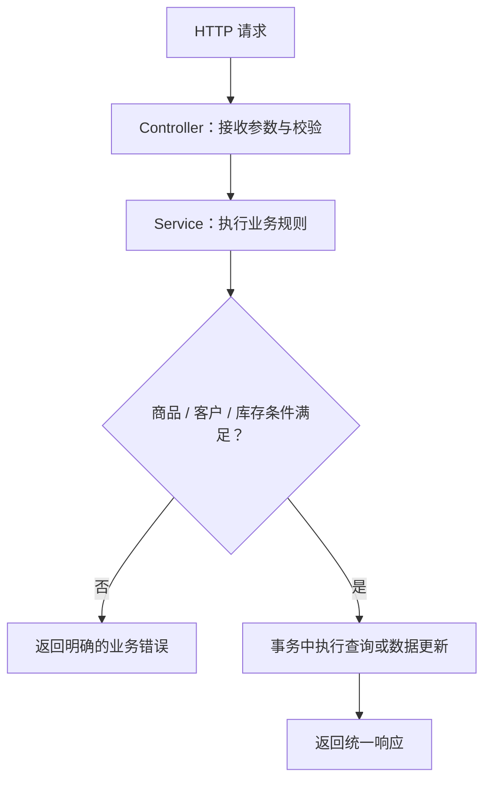

# 在线购物系统需求升级 A——后端接口设计与测试工作汇报

**软件工程实践课程项目 · 第10组**  
**汇报人：孙俊杰**  
**汇报日期：2026年11月12日**

## 一、后端需求分析

本次需求升级 A 包括商品管理升级（A.1）和客户管理升级（A.2）。与原有单商品线下交易模式相比，后端需要支持多商品同时在售、二级分类、库存管理、商品搜索、多图片、客户注册登录、个人历史订单以及商家查询客户购买记录等业务。

我的后端工作围绕三个方面展开：**新增接口设计、原有接口调整、接口与业务逻辑测试**。接口设计以 Spring Boot 的 Controller—Service 分层结构为基础，重点明确请求参数、返回数据和业务校验，确保需求 A 的各项后端功能均有对应的接口与测试场景。

## 二、需求 A 新增后端接口设计

### 2.1 商品管理接口（A.1）

| 接口 | 请求方式 | 设计内容 |
|---|---|---|
| `/api/products` | GET | 商品列表，支持关键词、分类、分页等组合查询 |
| `/api/products/{id}` | GET | 根据商品编号查询详情，返回库存、分类、描述及图片 |
| `/api/categories/tree` | GET | 查询二级商品分类结构 |
| `/api/admin/products/{id}/images` | POST | 为指定商品添加图片信息及展示顺序 |

其中，商品列表接口设计使用 `keyword`、`categoryId`、`page`、`size` 等查询参数。商品详情按商品编号查询，避免继续依赖“系统只有一件在售商品”的旧逻辑。图片接口支持一件商品关联多张图片，分类接口返回层级结构，便于进行分类查询。

### 2.2 客户管理接口（A.2）

| 接口 | 请求方式 | 设计内容 |
|---|---|---|
| `/api/customers/register` | POST | 注册客户，校验用户名、密码、电话及交易地点 |
| `/api/customers/login` | POST | 客户登录与身份验证 |
| `/api/customers/me/orders` | GET | 查询当前登录客户的历史订单 |
| `/api/admin/customers` | GET | 查询客户基本信息 |
| `/api/admin/customers/{id}/orders` | GET | 查询指定客户的历史购买记录 |

客户注册接口重点校验必填字段及用户名唯一性；登录接口负责核验账号密码。查询个人历史订单时，客户身份应由服务端验证，不能只凭请求传入的任意客户编号查询他人记录。

上述接口表为本轮**后端接口设计清单**，与仓库中已有的 Controller 实现分别列示，不将接口设计本身等同于实际运行验收。

## 三、原有后端接口的调整设计

挑战需求 A 不是重新建立一套交易系统，而是在现有商品发布、购买意向、交易处理流程上扩展能力。为此，我重点梳理了以下需要调整的接口及业务逻辑。

| 原有接口 | 调整内容 | 对应需求 |
|---|---|---|
| `POST /api/admin/products` | 商品创建参数增加分类和初始库存，并补充非负库存等校验 | 分类、库存 |
| `POST /api/admin/products/{id}/publish` | 去除原有“同一时刻仅允许一件商品在售”的限制 | 多商品上架 |
| `GET /api/admin/products` | 商品管理查询增加分类、状态及分页条件 | 多商品管理 |
| `POST /api/intents` | 处理客户身份、购买数量与库存充足性校验 | 客户关联、库存 |
| `POST /api/admin/trades/{id}/finish` | 成交时处理库存扣减、库存归零下架及交易状态一致性 | 库存自动下架 |
| `GET /api/products/current` | 保留兼容用途，主要查询改为按商品编号或商品列表获取 | 多商品查询 |

特别需要关注的是**库存处理与商品状态的一致性**。原有系统以 `ON_SALE`、`FROZEN`、`SOLD` 等状态描述单件商品交易；升级后需要进一步区分“商品还有库存”与“某笔交易正在处理”，不能将单件商品的冻结状态直接套用到全部库存。

库存扣减应进行充足性判断，并在同一事务中完成相关状态变更，避免重复提交或并发请求引发超卖。

### 后端处理流程

*图1　后端接口及业务规则处理流程*

## 四、后端测试工作

本次测试工作按功能模块组织用例，既覆盖正常请求，也关注参数错误、状态冲突、权限校验和并发更新等情况。

### 4.1 接口与业务测试用例

| 测试模块 | 重点测试场景 | 验证标准 |
|---|---|---|
| 多商品发布 | 连续发布两件合法商品 | 两件商品可同时处于在售状态 |
| 分类与搜索 | 一级、二级分类筛选及关键词组合查询 | 查询结果符合条件 |
| 库存管理 | 库存充足、库存不足、扣减至零 | 不出现负库存，库存为零后下架 |
| 商品图片 | 为一件商品添加多张图片 | 图片关联正确、顺序可读取 |
| 客户注册 | 正常注册、用户名重复、必填字段缺失 | 合法数据成功、非法数据被拒绝 |
| 客户登录 | 正确密码与错误密码 | 身份验证结果正确 |
| 历史订单 | 客户查询本人记录、尝试查询他人记录 | 记录归属正确，越权请求被拒绝 |
| 商家查询 | 客户列表与指定客户历史订单查询 | 返回相应客户及购买记录 |
| 交易一致性 | 重复提交、重复结算、并发扣减库存 | 不重复成交、不超卖 |

### 4.2 测试方法与现有测试基础

后端测试采用分层方式：使用 **JUnit 5 + Mockito** 对 Service 层的业务判断进行单元测试；使用 HTTP 接口请求检查参数与返回结构；使用独立测试环境检查交易、库存等需要持久化的业务流程。

当前仓库中已有 `ProductWithdrawTest.java`，覆盖下架影响预览、冻结状态禁止下架以及待处理意向取消等逻辑。原有 Docker 流程也包含商品发布、购买意向和交易状态的基础检查。这些已有测试用于验证升级前交易主线的稳定性；上表是**需求 A 的测试用例设计与验收检查项**，其执行结果应以实际测试记录为准。

## 五、后端工作总结

围绕挑战需求 A，我对商品管理与客户管理所需的后端能力进行了完整梳理，形成了**新增接口清单、现有接口调整方案和对应测试用例**。接口覆盖多商品、分类、库存、搜索、图片、客户账户和购买记录，测试方案同时考虑了非法输入、库存不足、身份权限和业务状态一致性。

这次后端工作的核心是明确需求升级后每个接口应该负责什么，以及如何验证其业务规则，为课堂汇报提供有结构、可核对的后端技术设计成果。

---

**项目仓库：** https://github.com/sjj124390/-  
**后端源码：** `backend/src/main/java/com/shop/online/`  
**已有单元测试：** `backend/src/test/java/com/shop/online/service/impl/ProductWithdrawTest.java`
