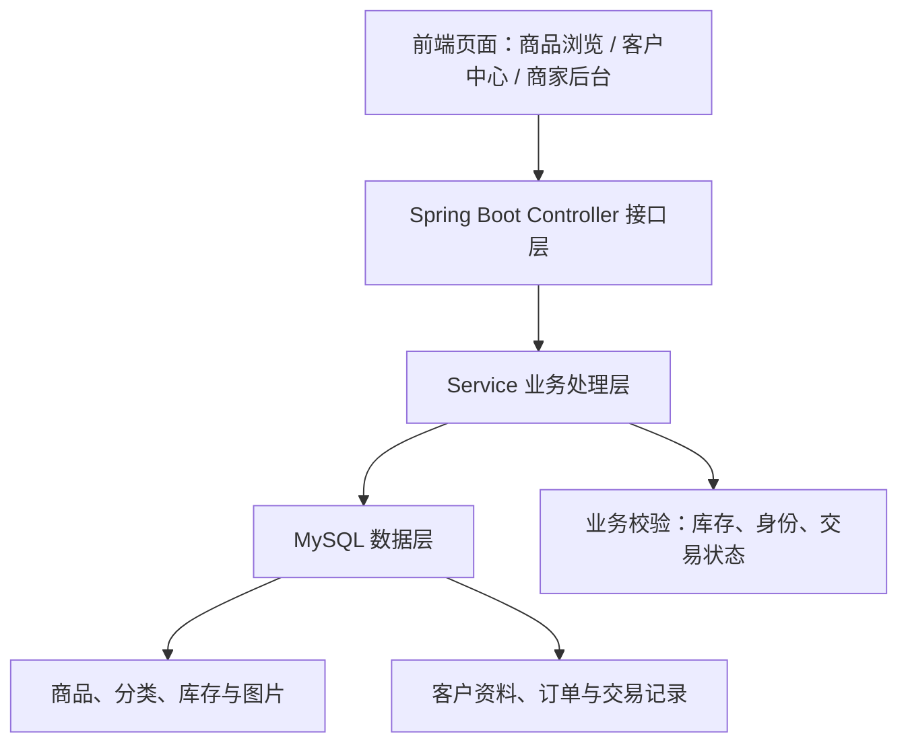

# 在线购物系统需求升级——后端接口设计与测试工作汇报

**软件工程实践课程项目｜第10组**  
**汇报人：孙俊杰｜2026年11月12日**

## 一、需求变化与后端工作目标

原有在线购物系统采用单卖家、单件商品在售和线下交易模式。买家无需注册，浏览商品后填写姓名、联系方式并提交购买意向；卖家负责商品发布、意向处理、交易结果确认和商品历史管理。现有后端以 Spring Boot、Spring JDBC 和 MySQL 实现上述业务，核心数据表包括 `seller`、`product`、`purchase_intent` 和 `offline_trade`。

本次**挑战需求 A**在基线功能上新增两方面内容：**A.1 商品管理升级**（支持多商品、二级分类、库存、搜索和多图片），以及**A.2 客户升级**（客户注册与登录、历史订单查询、商家查看客户及购买记录）。

后端工作的重点不再只是维护一件商品的交易状态，而是设计多商品和客户数据的访问接口，调整原有交易逻辑，并建立相应的测试用例。本稿以当前仓库代码为基础整理接口设计；尚未实现的升级接口属于本轮设计方案。

## 二、需求升级后拟新增的后端接口

新增接口按“商品管理”和“客户管理”分组，初步使用 REST 风格设计，统一通过现有的 `/api` 路径对外提供服务。

| 业务模块 | 请求方式及接口 | 主要功能 |
|---|---|---|
| 商品浏览 | `GET /api/products` | 查询多个商品，支持关键词、分类及分页参数 |
| 商品详情 | `GET /api/products/{id}` | 查看指定商品的价格、库存、描述和图片 |
| 分类管理 | `GET /api/categories/tree` | 返回一级、二级分类的树形数据 |
| 商品图片 | `POST /api/admin/products/{id}/images` | 为商品保存多张图片及其展示顺序 |
| 客户注册 | `POST /api/customers/register` | 校验用户名、密码、电话及交易地点，并建立客户档案 |
| 客户登录 | `POST /api/customers/login` | 校验客户账号，为查询个人订单提供身份依据 |
| 个人订单 | `GET /api/customers/me/orders` | 查询当前登录客户的历史购买记录 |
| 商家客户管理 | `GET /api/admin/customers` | 查询客户列表及基本资料 |
| 商家购买记录 | `GET /api/admin/customers/{id}/orders` | 查询指定客户的历史购买记录 |

其中，商品列表接口重点考虑组合查询：例如同时传入 `keyword`、`categoryId`、`page` 和 `size`，后端负责筛选、排序及分页。客户订单接口需要通过服务端识别当前登录客户，不能仅依赖前端传入客户编号。

## 三、原有接口需要调整的内容

需求升级并不意味着全部重新开发。商品发布、购买意向与交易处理的基本流程可以保留，但需要根据多商品、库存和客户身份补充业务规则。

| 现有接口或模块 | 需要调整的内容 | 调整目的 |
|---|---|---|
| `POST /api/admin/products` | 新增分类、初始库存等字段，完善商品参数校验 | 支持多商品及库存管理 |
| `POST /api/admin/products/{id}/publish` | 调整“只能有一件在售商品”的发布约束 | 允许多件商品同时上架 |
| `GET /api/admin/products` | 增加分页、分类、库存和状态筛选 | 满足商家批量管理商品的需求 |
| `POST /api/intents` | 评估关联登录客户、购买数量与库存校验 | 将原有购买意向与客户、库存建立联系 |
| `POST /api/admin/trades/{id}/finish` | 在成交处理时同步扣减库存，库存为零时下架 | 保障交易结果与库存状态一致 |
| `FacadeController` 适配层 | 同步调整前端请求参数、商品列表和状态映射 | 减少原有前端与新接口之间的兼容问题 |

这里有一个必须首先解决的数据库问题：当前 `product` 表中的 `uq_one_active_product` 唯一索引限制了同时在售商品数量。实现 A.1 前，既要调整这一约束，也要为商品补充库存、分类及图片关联；客户升级则需要相应的客户和订单数据关系。**单纯增加 Controller 方法，不能完成这些业务升级。**

### 后端扩展结构示意

*图1：挑战需求 A 的后端模块扩展思路。图中新增模块为设计目标，并非全部已部署完成。*

## 四、后端测试工作

后端测试分为**现有代码验证**和**升级功能测试设计**两部分，分别记录，避免将原有交易流程的测试结果直接等同于挑战需求 A 的验收结果。

### 4.1 现有代码的测试基础

当前仓库中已包含 `ProductWithdrawTest.java`，使用 JUnit 5 和 Mockito 对手动下架相关逻辑设置三个测试场景：

1. 在售商品下架前，能够统计待处理购买意向并返回确认信息。
2. 交易冻结中的商品不能直接下架。
3. 下架商品时应执行取消待处理购买意向的操作。

此外，现有 Docker 构建流程包含商品发布、购买意向、冻结、交易成功与失败恢复等基础交易链路检查。这部分验证为后续需求升级提供回归测试基础，但**不代表多商品、库存或客户管理等新功能已经通过测试**。

### 4.2 挑战需求 A 的测试用例设计

| 测试方向 | 主要测试场景 | 预期结果 |
|---|---|---|
| 多商品发布 | 连续发布两件符合要求的商品 | 两件商品均可处于在售状态 |
| 二级分类 | 按一级、二级分类查询商品 | 返回的商品与分类关系正确 |
| 搜索与分页 | 使用关键词、分类及分页条件组合查询 | 结果准确，分页参数有效 |
| 库存处理 | 库存充足、库存不足、扣减后库存为零 | 不允许超卖；库存为零时下架 |
| 多图片展示 | 为同一商品保存多张图片 | 图片与商品关联正确，顺序可读取 |
| 客户注册及登录 | 重复用户名、错误密码、合法注册登录 | 非法请求被拒绝，合法请求成功 |
| 历史订单与权限 | 客户查看本人订单、商家查询客户购买历史 | 查询结果正确，不泄露其他客户的私有记录 |

测试方法上，优先使用 JUnit 5、Mockito 验证 Service 层业务分支，再通过接口请求和独立 MySQL 测试库验证真实的数据变更。对库存扣减、重复提交等并发或事务场景，还需要执行集成测试，检查数据一致性。

## 五、现阶段成果与下一步安排

截至本次汇报，仓库已有基线交易功能、手动下架相关逻辑、部分单元测试和 Docker 运行配置。本轮已经明确挑战需求 A 对后端新增的接口范围、需要调整的原有接口，以及重点测试场景。当前代码仍以单商品交易模式为主，**多商品、库存、分类和客户体系尚不能按“已经全部完成”汇报**。

接下来的开发计划是：首先与数据库模块确定分类、库存、图片、客户和订单的数据结构；随后按商品管理、客户管理两个模块逐步实现接口，并与前端统一字段和返回格式；最后以实际运行结果补全单元测试、接口测试和联调记录。

本轮后端工作的核心目标，是在保留现有交易流程的基础上，使系统具备扩展为多商品、可管理库存、可关联客户历史记录的能力，并通过测试验证新增业务规则。

---

**项目仓库：** https://github.com/sjj124390/-  
**相关源码：** `backend/src/main/java/com/shop/online/controller/`、`backend/src/main/java/com/shop/online/service/`  
**现有测试：** `backend/src/test/java/com/shop/online/service/impl/ProductWithdrawTest.java`
