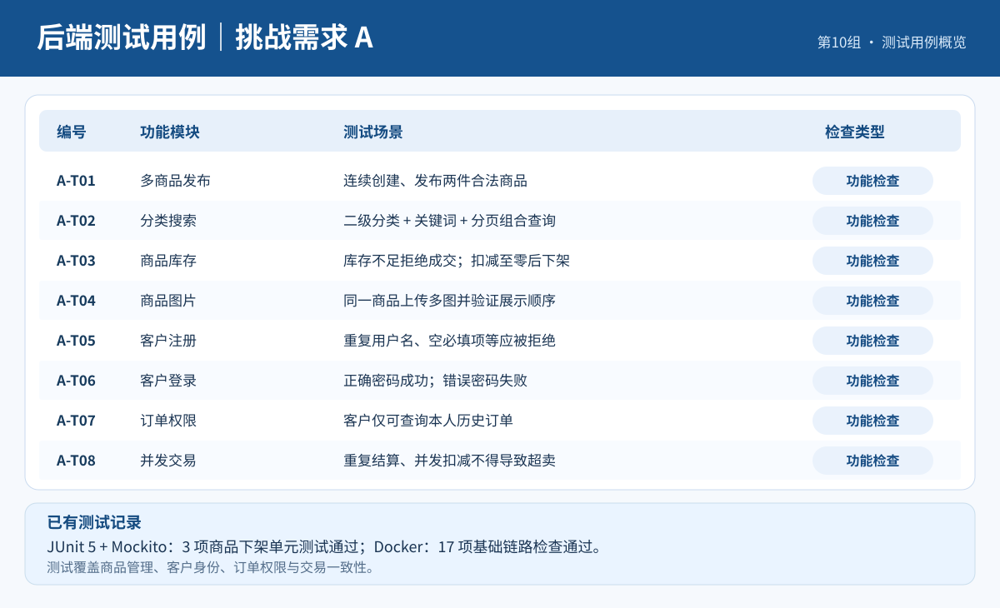
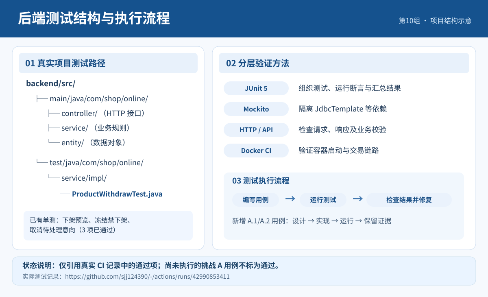

# 需求升级 A：后端接口与测试工作汇报

**软件工程实践 · 第10组**  
**汇报人：孙俊杰**  
**日期：2026年11月11日**

## 一、后端接口工作

本次围绕挑战需求 A 的商品管理（A.1）与客户管理（A.2），整理后端接口及参数校验要求，重点包括多商品、分类查询、库存、商品图片、客户注册登录与订单查询。接口按 Controller 接收请求、Service 处理业务规则的方式组织。

| 功能 | HTTP 接口 | 业务处理要点 |
|---|---|---|
| 商品查询 | `GET /api/products` | 支持关键词、分类、分页组合查询 |
| 商品详情 | `GET /api/products/{id}` | 按商品编号返回详情、库存与图片 |
| 分类查询 | `GET /api/categories/tree` | 返回一级与二级分类 |
| 图片管理 | `POST /api/admin/products/{id}/images` | 管理商品多图片及展示顺序 |
| 客户注册 | `POST /api/customers/register` | 校验必填字段、用户名唯一性 |
| 客户登录 | `POST /api/customers/login` | 验证账号与密码 |
| 我的订单 | `GET /api/customers/me/orders` | 按服务端确认的客户身份查询订单 |
| 客户列表 | `GET /api/admin/customers` | 查询客户资料 |
| 客户订单 | `GET /api/admin/customers/{id}/orders` | 查询指定客户历史购买记录 |
| 商品发布调整 | `POST /api/admin/products/{id}/publish` | 支持多商品在售 |
| 交易结算调整 | `POST /api/admin/trades/{id}/finish` | 库存扣减与订单状态同步处理 |

## 二、后端测试用例

测试内容覆盖正常业务、错误输入、身份权限及交易一致性。以下列出挑战需求 A 对应的全部 10 个验收用例及验证标准。

*图1　后端测试用例概览*

| 编号 | 测试模块 | 输入或操作 | 验证标准 |
|---|---|---|---|
| A-T01 | 多商品发布 | 连续创建并发布两件合法商品 | 两件商品均能够在售 |
| A-T02 | 分类搜索 | 组合使用二级分类、关键词与分页参数 | 返回符合筛选条件的数据 |
| A-T03 | 库存管理 | 对库存为 1 的商品连续提交购买请求 | 正确扣减库存，库存不足时拒绝购买 |
| A-T04 | 商品图片 | 为同一商品添加多张图片并设置顺序 | 图片关联及展示顺序正确 |
| A-T05 | 客户注册 | 分别提交合法信息、重复用户名和缺失字段 | 合法信息可注册，非法信息被拒绝 |
| A-T06 | 客户登录 | 使用正确及错误密码登录 | 登录验证符合要求 |
| A-T07 | 订单权限 | 客户查询本人订单，并尝试查询他人订单 | 拒绝越权访问 |
| A-T08 | 并发交易 | 库存为 1 时并发购买并重复结算 | 不出现超卖或重复成交 |
| A-T09 | 商家客户查询 | 查询客户资料及对应购买记录 | 返回正确客户及订单信息 |
| A-T10 | 参数校验 | 提交非法价格、负库存、不存在商品编号 | 拒绝非法参数并返回错误信息 |

## 三、测试方法与执行记录

后端采用 JUnit 5、Mockito 验证 Service 层的业务规则，并通过 GitHub Actions 中的 Docker Compose 集成检查验证现有商品发布、购买意向及交易流程。

*图2　后端测试结构与执行流程*

### 3.1 Java 单元测试

测试文件：`backend/src/test/java/com/shop/online/service/impl/ProductWithdrawTest.java`

| 测试方法 | 检查内容 | 结果 |
|---|---|---|
| `previewReportsPendingIntents()` | 在售商品下架预览和待处理意向数量 | 通过 |
| `tradeFrozenCannotBeWithdrawn()` | 交易冻结期间禁止直接下架 | 通过 |
| `withdrawCancelsPendingIntents()` | 下架时取消待处理购买意向的服务调用 | 通过 |

### 3.2 Docker 集成检查

GitHub Actions 记录显示，Java 单元测试 **3 项通过**（0 失败），Docker 商品及交易链路检查 **17 项通过**。检查覆盖卖家登录、商品发布、购买意向提交、查询口令、商品冻结、失败恢复和成交状态等业务。

运行记录：[2026-11-11 GitHub Actions](https://github.com/sjj124390/-/actions/runs/42990853411)

## 四、工作总结

本次整理了挑战需求 A 的后端接口清单、10 项验收测试用例以及已有代码的单元测试与集成检查记录，重点关注商品管理、客户数据、订单权限和交易状态一致性，为后续接口开发与功能验收提供对应依据。

**代码仓库：** https://github.com/sjj124390/-
