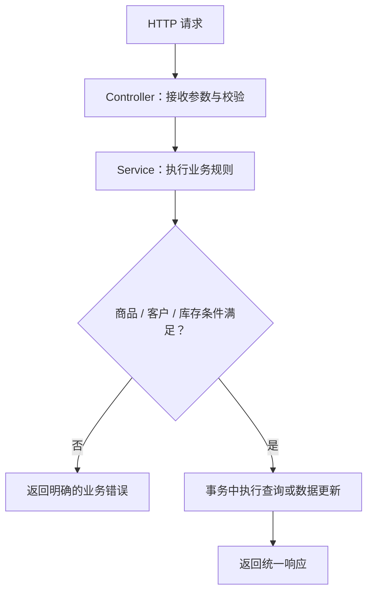

# 在线购物系统需求升级 A——后端接口设计与测试工作汇报

**软件工程实践课程项目 · 第10组**  
**汇报人：孙俊杰**  
**汇报日期：2026年11月12日**

## 一、后端需求分析

本次需求升级 A 包括商品管理升级（A.1）和客户管理升级（A.2）。与原有单商品线下交易模式相比，后端需要支持多商品同时在售、二级分类、库存管理、商品搜索、多图片、客户注册登录、个人历史订单以及商家查询客户购买记录等业务。

我的后端工作围绕三个方面展开：**新增接口设计、原有接口调整、接口与业务逻辑测试**。接口设计以 Spring Boot 的 Controller—Service 分层结构为基础，重点明确请求参数、返回数据和业务校验，确保需求 A 的各项后端功能均有对应的接口与测试场景。

## 二、需求 A 新增后端接口设计

### 2.1 商品管理接口（A.1）

| 接口 | 请求方式 | 设计内容 |
|---|---|---|
| `/api/products` | GET | 商品列表，支持关键词、分类、分页等组合查询 |
| `/api/products/{id}` | GET | 根据商品编号查询详情，返回库存、分类、描述及图片 |
| `/api/categories/tree` | GET | 查询二级商品分类结构 |
| `/api/admin/products/{id}/images` | POST | 为指定商品添加图片信息及展示顺序 |

其中，商品列表接口设计使用 `keyword`、`categoryId`、`page`、`size` 等查询参数。商品详情按商品编号查询，避免继续依赖“系统只有一件在售商品”的旧逻辑。图片接口支持一件商品关联多张图片，分类接口返回层级结构，便于进行分类查询。

### 2.2 客户管理接口（A.2）

| 接口 | 请求方式 | 设计内容 |
|---|---|---|
| `/api/customers/register` | POST | 注册客户，校验用户名、密码、电话及交易地点 |
| `/api/customers/login` | POST | 客户登录与身份验证 |
| `/api/customers/me/orders` | GET | 查询当前登录客户的历史订单 |
| `/api/admin/customers` | GET | 查询客户基本信息 |
| `/api/admin/customers/{id}/orders` | GET | 查询指定客户的历史购买记录 |

客户注册接口重点校验必填字段及用户名唯一性；登录接口负责核验账号密码。查询个人历史订单时，客户身份应由服务端验证，不能只凭请求传入的任意客户编号查询他人记录。

上述接口表为本轮**后端接口设计清单**，与仓库中已有的 Controller 实现分别列示，不将接口设计本身等同于实际运行验收。

## 三、原有后端接口的调整设计

挑战需求 A 不是重新建立一套交易系统，而是在现有商品发布、购买意向、交易处理流程上扩展能力。为此，我重点梳理了以下需要调整的接口及业务逻辑。

| 原有接口 | 调整内容 | 对应需求 |
|---|---|---|
| `POST /api/admin/products` | 商品创建参数增加分类和初始库存，并补充非负库存等校验 | 分类、库存 |
| `POST /api/admin/products/{id}/publish` | 去除原有“同一时刻仅允许一件商品在售”的限制 | 多商品上架 |
| `GET /api/admin/products` | 商品管理查询增加分类、状态及分页条件 | 多商品管理 |
| `POST /api/intents` | 处理客户身份、购买数量与库存充足性校验 | 客户关联、库存 |
| `POST /api/admin/trades/{id}/finish` | 成交时处理库存扣减、库存归零下架及交易状态一致性 | 库存自动下架 |
| `GET /api/products/current` | 保留兼容用途，主要查询改为按商品编号或商品列表获取 | 多商品查询 |

特别需要关注的是**库存处理与商品状态的一致性**。原有系统以 `ON_SALE`、`FROZEN`、`SOLD` 等状态描述单件商品交易；升级后需要进一步区分“商品还有库存”与“某笔交易正在处理”，不能将单件商品的冻结状态直接套用到全部库存。

库存扣减应进行充足性判断，并在同一事务中完成相关状态变更，避免重复提交或并发请求引发超卖。

### 后端处理流程



*图1　后端接口及业务规则处理流程*

## 四、后端测试工作

本次将**已执行的原有系统回归测试**与**挑战需求 A 的新增测试用例设计**分开记录。测试用例按功能模块、输入条件和预期结果组织，不因写出了设计表就认定功能已经实现或测试通过。

### 4.1 测试范围与用例设计图


*图2　挑战需求 A 后端测试用例设计图。图中 A 类用例为设计方案，不是测试执行截图。*

### 4.2 挑战需求 A 详细测试用例

下表为待在升级接口开发完成后执行的检查项。“待执行”表示**不能把预期结果写成实测结果**。

| 用例编号 | 功能模块 | 输入与操作 | 预期结果 | 执行状态 |
|---|---|---|---|---|
| A-T01 | 多商品发布 | 管理员依次创建并发布商品 A、商品 B，均为合法参数 | 两件商品同时在售；不再被原来的单商品唯一限制拦截 | 待执行 |
| A-T02 | 分类与搜索 | 使用一级/二级分类、关键词、分页参数进行组合查询 | 返回的商品均符合筛选条件，分页数量和总数正确 | 待执行 |
| A-T03 | 库存管理 | 对库存为 1 的商品先购买 1 件，再发起另一笔购买请求 | 第一次库存正确扣减至 0；第二次拒绝，商品不可继续购买 | 待执行 |
| A-T04 | 商品图片 | 为一件商品关联多张图片，并设置不同展示顺序 | 图片均关联正确商品，返回顺序符合配置 | 待执行 |
| A-T05 | 客户注册 | 分别提交合法注册信息、重复用户名、缺少必填字段的信息 | 合法注册成功；重复或缺失字段返回明确错误，不新增无效账户 | 待执行 |
| A-T06 | 客户登录 | 使用正确密码和错误密码分别登录 | 正确密码通过验证；错误密码被拒绝，敏感信息不泄露 | 待执行 |
| A-T07 | 个人订单权限 | 客户 A 查询自己的订单，再尝试使用客户 B 的编号查询订单 | 仅允许访问本人订单；不能通过修改请求参数越权查看 | 待执行 |
| A-T08 | 并发交易 | 对库存为 1 的商品并发提交两笔有效购买请求，并重复调用结算 | 不出现负库存、超卖或重复成交，关键变更保持一致 | 待执行 |
| A-T09 | 商家客户查询 | 商家查询客户列表和指定客户的购买记录 | 返回目标客户及订单，字段与权限符合接口设计 | 待执行 |
| A-T10 | 非法参数处理 | 请求中提交非法商品价格、负库存、不存在的商品编号 | 返回清晰的校验或不存在提示，不产生错误数据 | 待执行 |

**建议执行顺序：** 先用单元测试验证 Service 的校验与状态变化，再进行 Controller/API 请求测试，最后在独立数据库环境执行库存扣减、并发以及权限相关的集成测试。每项测试保留命令、断言结果或可复现的记录。

### 4.3 测试工具与实际项目结构


*图3　基于当前仓库结构整理的测试方法和执行流程示意图。图中仅“3 项单元测试”“17 项基础链路检查”为已核实的历史 CI 结果。*

本项目后端使用 **JUnit 5 + Mockito** 编写 Service 层单元测试，以 HTTP 请求检查接口输入和返回结构，并使用 **GitHub Actions + Docker Compose** 在独立容器环境中检查既有交易链路。

当前仓库真实存在的测试类为：

`backend/src/test/java/com/shop/online/service/impl/ProductWithdrawTest.java`

| 现有测试方法 | 测试内容 | 已有记录 |
|---|---|---|
| `previewReportsPendingIntents()` | 在售商品下架预览：返回待处理意向数量及不会自动通知买家的提示 | JUnit 通过 |
| `tradeFrozenCannotBeWithdrawn()` | 交易冻结状态禁止直接下架，且不应继续取消意向 | JUnit 通过 |
| `withdrawCancelsPendingIntents()` | 商品下架成功后调用待处理意向取消逻辑 | JUnit 通过 |

**实际执行依据：** 2026-11-11 的 [GitHub Actions 成功运行记录](https://github.com/sjj124390/-/actions/runs/42990853411) 中，Maven 显示 `Tests run: 3, Failures: 0, Errors: 0, Skipped: 0`；容器冒烟测试显示 `Docker integration smoke test passed: 17 checks`。这两项结果验证的是**仓库当时已有的基础功能与部署链路**，不是上表 A-T01 至 A-T10 的执行结果。

对应的复测入口：

```sh
# 后端单元测试（在仓库根目录）
cd backend
mvn test

# Docker 端到端检查（回到根目录后，仅在全新、可丢弃的测试数据库执行）
docker compose build
docker compose up -d --no-build --wait --wait-timeout 240
python3 deploy/docker/smoke_test.py --allow-write
```

由于脚本会写入演示数据，不能直接对正式或需要保留数据的数据库执行。新增的多商品、库存、客户注册登录和个人订单等需求 A 用例，须待对应接口落地后单独执行与记录。

## 五、后端工作总结

围绕挑战需求 A，我对商品管理与客户管理所需的后端能力进行了完整梳理，形成了**新增接口清单、现有接口调整方案和对应测试用例**。接口覆盖多商品、分类、库存、搜索、图片、客户账户和购买记录，测试方案同时考虑了非法输入、库存不足、身份权限和业务状态一致性。

这次后端工作的核心是明确需求升级后每个接口应该负责什么，以及如何验证其业务规则，为课堂汇报提供有结构、可核对的后端技术设计成果。

---

**项目仓库：** https://github.com/sjj124390/-  
**后端源码：** `backend/src/main/java/com/shop/online/`  
**已有单元测试：** `backend/src/test/java/com/shop/online/service/impl/ProductWithdrawTest.java`
