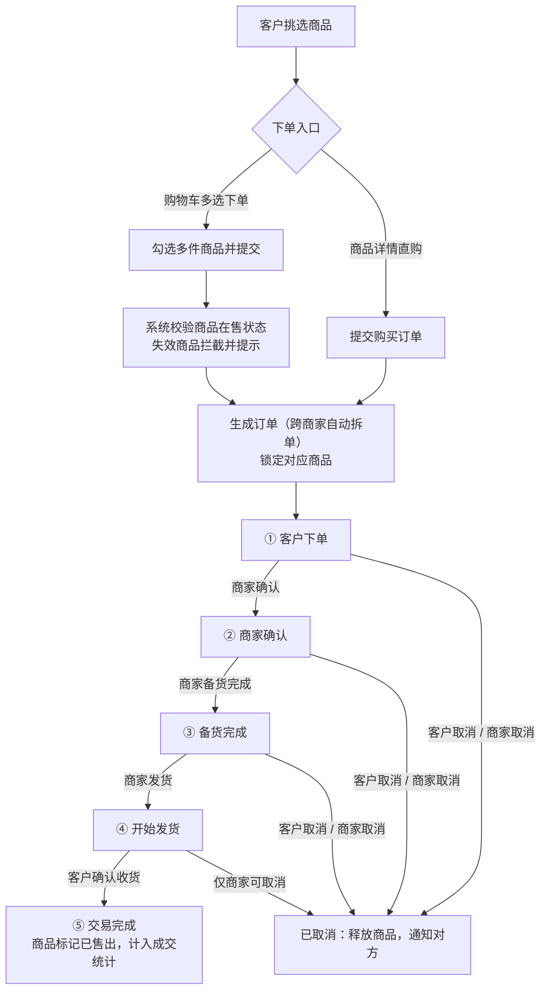
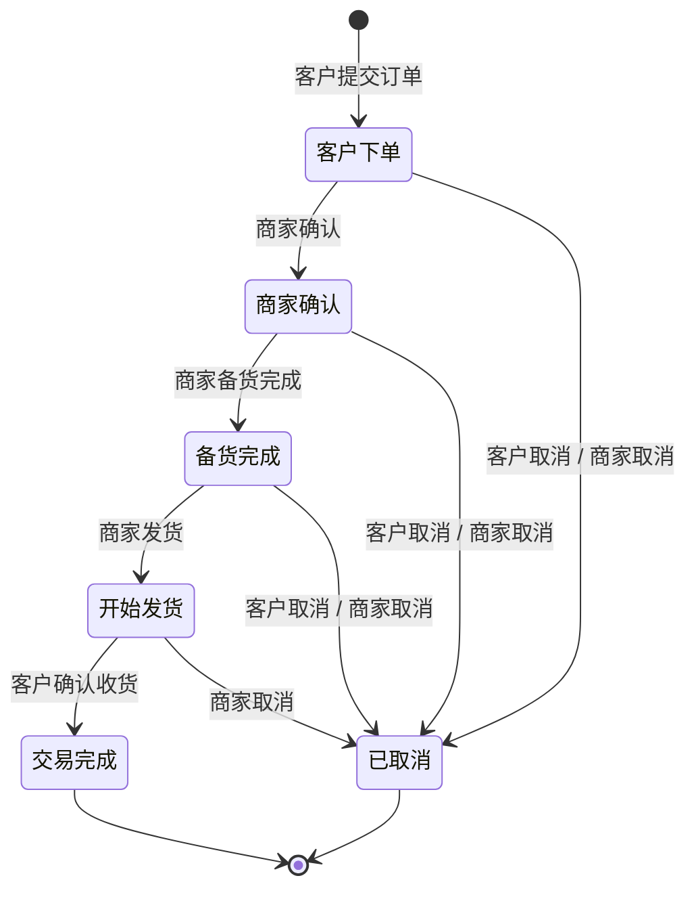

# 订单业务流程及状态流转说明

| 项目 | 内容 |
| --- | --- |
| 负责成员 | 陆峻辉（需求分析） |
| 文档版本 | V2.0（按挑战需求B 官方定义修订） |
| 适用范围 | 迭代三 · 挑战需求B：B.1 订单升级——订单创建、状态机、进度追踪、取消与异常处理 |

---

## 1. 订单模型概述

依据挑战需求B 官方定义，原"意向订单"（待交易 / 交易成功 / 交易失败 三态）升级为标准订单模型：

- **订单状态（5 个正向状态）**：**客户下单 → 商家确认 → 备货完成 → 开始发货 → 交易完成**；另设**已取消**作为终止状态；
- **订单来源**：购物车多选下单或商品详情单品直购；选中商品分属不同商家时，按商家拆分为独立订单，各自独立流转；
- **取消窗口**：开始发货前客户可取消；交易完成前商家可取消；
- **订单与商品**：二手单品数量恒为 1，提交订单即锁定商品，取消后自动释放，交易完成后商品转已售出。

## 2. 订单主业务流程

## 3. 订单状态定义

| 状态 | 枚举值 | 含义 | 商品锁定 | 进入条件 |
| --- | --- | --- | --- | --- |
| 客户下单 | CREATED | 订单已生成，等待商家确认 | 是 | 客户提交订单 |
| 商家确认 | CONFIRMED | 商家已接单，进入备货环节 | 是 | 商家确认 |
| 备货完成 | PREPARED | 商品已备妥，等待发货 | 是 | 商家标记备货完成 |
| 开始发货 | SHIPPED | 商品已发出，等待客户收货 | 是 | 商家发货 |
| 交易完成 | COMPLETED | 客户确认收货，交易闭环（终态） | 否（商品转已售出） | 客户确认收货 |
| 已取消 | CANCELLED | 交易终止，商品已释放（终态） | 否（释放） | 客户取消（开始发货前）/ 商家取消（交易完成前） |

## 4. 订单状态流转图

## 5. 状态流转规则明细

| 序号 | 前置状态 | 触发者 | 动作 | 后置状态 | 副作用 |
| --- | --- | --- | --- | --- | --- |
| T1 | —（创建） | 客户 | 提交订单（购物车多选/直购） | 客户下单 | 锁定商品，通知商家 |
| T2 | 客户下单 | 商家 | 确认订单 | 商家确认 | 通知客户 |
| T3 | 商家确认 | 商家 | 备货完成 | 备货完成 | 通知客户 |
| T4 | 备货完成 | 商家 | 发货 | 开始发货 | 通知客户；此后客户不可再取消 |
| T5 | 开始发货 | 客户 | 确认收货 | 交易完成 | 商品转"已售出"，计入商家成交统计，通知商家 |
| T6 | 客户下单 / 商家确认 / 备货完成 | 客户 | 取消订单 | 已取消 | 释放商品，记录取消原因，通知商家 |
| T7 | 客户下单 / 商家确认 / 备货完成 / 开始发货 | 商家 | 取消订单（必填原因） | 已取消 | 释放商品，记录取消原因，通知客户 |

**约束：**

1. 交易完成、已取消为终态，**不可逆向流转**；已取消订单不可恢复，需重新下单；
2. 五个正向状态仅允许按序推进，跳变（如客户下单直接发货）一律拒绝；
3. 客户在开始发货及之后发起取消、商家在交易完成后发起取消，均返回明确错误提示；
4. 所有流转操作幂等，重复请求返回当前状态而不重复执行副作用；
5. 每次流转写入 `order_status_log`（订单号、前置/后置状态、操作者、时间、原因）。

## 6. 交易进度追踪展示

客户端订单详情的进度组件按以下五节点渲染（沿用迭代二 UI 样式，扩展节点）：

| 节点 | 对应状态 | 展示说明 |
| --- | --- | --- |
| ① 客户下单 | 客户下单 | 显示下单时间 |
| ② 商家确认 | 商家确认 | 未确认时显示"等待商家确认" |
| ③ 备货完成 | 备货完成 | 备货中显示当前节点高亮 |
| ④ 开始发货 | 开始发货 | 显示发货时间 |
| ⑤ 交易完成 | 交易完成 | 显示完成时间 |

订单进入"已取消"时，进度条转为终止样式，展示取消方、取消原因与商品释放提示。

## 7. 异常与并发处理

| 场景 | 处理策略 |
| --- | --- |
| 客户取消与商家发货并发 | 以先完成的事务为准：若发货先生效，客户取消被拒绝并提示"订单已发货"；反之商家发货时订单已取消则操作失败 |
| 商家确认与客户取消并发 | 同上，以先完成的事务为准，后者提示"订单状态已变更，请刷新" |
| 同一商品被同时提交订单 | 数据库行锁/乐观锁保证仅一笔订单锁定成功，其余提示"商品已被抢购" |
| 重复提交（双击、网络重试） | 幂等处理，返回当前订单状态，不重复执行副作用 |
| 进行中订单的商品被商家下架/删除 | 存在进行中订单（客户下单/商家确认/备货完成/开始发货）的商品禁止下架或删除，须先取消订单 |
