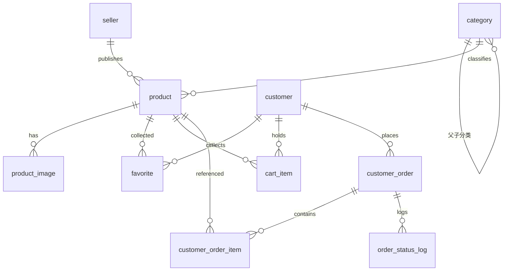
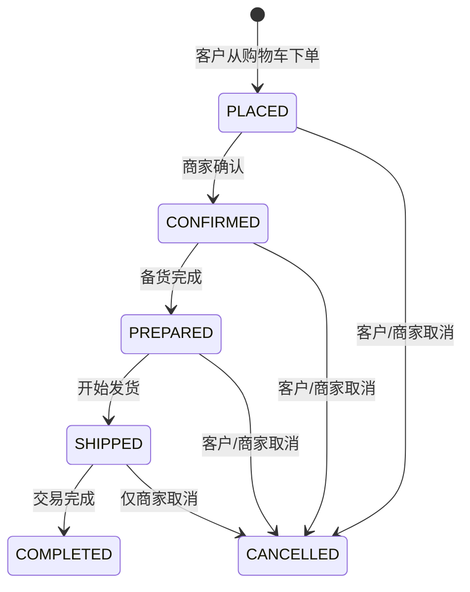

# 需求 B · 数据库设计说明

**第 10 组 · 朱江（数据库负责人）**
**日期：2026-11-18**

## 应用联调

运行前按 [需求 B 启动说明](../README.md) 导入 `schema-b.sql` 和 `integration-b.sql`。后者仅为应用联调增加销量、下架原因和订单封面快照字段，并保留已有订单及明细。`seed-demo-b.sql` 在应用第一次启动后补充演示商品。应用通过 Spring Boot 事务执行下单、修改订单和库存变化，也写入 `order_status_log`。

本页下文保留数据库阶段的独立 SQL 设计和原始验收记录。`verify-b.sql` 会清理表中业务数据，请在单独的数据库实例验收。该阶段的存储过程用于数据库设计验证，页面从后端 API 访问数据库。

## 1. 范围

本方案覆盖挑战需求 A 与挑战需求 B 对数据层的要求：

| 需求 | 内容 | 对应实现 |
|---|---|---|
| A.1 商品管理升级 | 多商品在售、二级分类、库存、浏览与搜索、多图与富媒体描述 | `product`、`category`、`product_image`、全文索引 |
| A.2 客户升级 | 客户注册登录、查看历史订单、商家查看客户与购买记录 | `customer` + `customer_order` 关联查询 |
| B.1 订单升级 | 五状态订单（下单→确认→备货完成→开始发货→交易完成）、双方取消规则 | `customer_order`、`order_status_log`、`advance_order`、`cancel_order` |
| B.2 商品预选升级 | 收藏、购物车、多件下单、购物车转收藏 | `favorite`、`cart_item`、`place_order`、`cart_to_favorite` |

相对基线库（`database/schema.sql`，单商品 + 购买意向模型）的主要变化：

1. 移除 `active_slot` 唯一约束，支持多件商品同时在售；
2. 商品增加 `category_id`、`stock`，库存为 0 由触发器自动下架；
3. 新增客户体系（注册 / 登录 / 默认交易地点）；
4. 新增收藏、购物车，支持勾选多件商品一次性下单；
5. 订单模型由「购买意向 + 线下交易」升级为「订单 + 订单明细 + 状态流水」；
6. 下单原子扣减库存、取消回补库存，防超卖由数据库层保证。

## 2. 文件与安装

| 文件 | 说明 |
|---|---|
| `schema-b.sql` | 建库、建表、索引、视图、触发器、存储过程（一次性安装） |
| `verify-b.sql` | 正向验收脚本：初始化演示数据并跑通下单、状态流转、取消、转收藏 |
| `verify-b-negative.sql` | 负向验收用例：验证库存、状态、取消规则被数据库拦截 |

安装与验收：

```bash
mysql -u root -p < schema-b.sql

mysql -u root -p --default-character-set=utf8mb4 < verify-b.sql
mysql -u root -p --default-character-set=utf8mb4 --force < verify-b-negative.sql
```

脚本使用独立库 `shop_req_b`，不覆盖已通过验收的基线库 `single_item_shop`；重复执行会在同名表处报错，不会删除已有数据。`verify-b.sql` 可重复执行（开头清理业务数据）。

## 3. 表结构

| 表 | 用途 | 主要字段与约束 |
|---|---|---|
| `seller` | 唯一卖家 | `id` 只能为 1；`username` 唯一；密码只存哈希 |
| `category` | 二级分类 | `parent_id` 为空表示一级；`parent_key` 生成列保证同层级名称唯一；触发器禁止自引用 |
| `product` | 商品 | `category_id`、`stock`、`status`；价格正数；名称与描述建 ngram 全文索引 |
| `product_image` | 商品多图 | `(product_id, sort_order)` 唯一，保证展示顺序不重复 |
| `customer` | 客户 | `username` 唯一；`phone`、`default_location` |
| `favorite` | 收藏 | `(customer_id, product_id)` 主键，天然防重复收藏 |
| `cart_item` | 购物车 | `(customer_id, product_id)` 主键，同商品只一行；数量 1~999 |
| `customer_order` | 订单 | 五状态 + 取消；买家、电话、交易地点快照；取消时 `cancelled_at`、`cancel_actor` 必须同时写入（CHECK） |
| `customer_order_item` | 订单明细 | `(order_id, product_id)` 主键；名称与单价快照，保证历史金额不受改价影响 |
| `order_status_log` | 状态流水 | 记录每次状态变更的 `from_status`、`to_status`、`actor` |

视图：

- `v_cart_detail`：购物车联表（名称、价格、库存、数量），对应前端购物车条目契约；
- `v_order_detail`：订单联表（主表 + 明细），对应前端订单契约。

## 4. E-R 关系



## 5. 状态机与业务规则

### 5.1 订单状态



| 规则（课程要求） | 数据库实现 |
|---|---|
| 客户在「开始发货」前可取消 | `cancel_order` 中校验 `p_actor='CUSTOMER' AND status='SHIPPED'` 时报错 |
| 商家在「交易完成」前可取消 | 订单为 `COMPLETED` 时任何角色取消均报错 |
| 状态只能逐级推进 | `advance_order` 校验四组合法转移，其余全部拒绝 |
| 取消需留痕 | `cancel_actor`、`cancel_reason`、`cancelled_at` + `order_status_log` |

### 5.2 存储过程

| 过程 | 作用 | 关键校验 |
|---|---|---|
| `publish_product(product_id)` | 商品上架 | 库存必须大于 0 |
| `withdraw_product(product_id)` | 手动下架 | 仅在售商品可下架 |
| `merge_cart_item(customer, product, qty)` | 加入购物车 | 商品在售；累计数量不超过库存 |
| `place_order(customer, product_ids_json)` | 多件下单 | 勾选项必须在购物车；原子扣库存；生成快照与流水 |
| `advance_order(order, target)` | 推进状态 | 只允许逐级流转 |
| `cancel_order(order, actor, reason)` | 取消订单 | 按角色与状态强制取消规则；回补库存 |
| `cart_to_favorite(customer, product_ids_json)` | 购物车转收藏 | 幂等（已收藏忽略），转换后移除购物车项 |

所有过程自行管理事务，失败统一 `SIGNAL SQLSTATE '45000'`，应用层按消息映射为中文提示，**不得在应用已开启的事务中调用**。

### 5.3 库存规则

- 下单：`UPDATE product SET stock = stock - quantity WHERE status='ON_SALE' AND stock >= quantity`，按影响行数判断是否充足，库存不足时整单回滚；
- 售罄：`trg_product_zero_stock_offline` 触发器把库存为 0 的在售商品自动置为 `OFF_SHELF`（A.1.3）；
- 取消：按明细回补库存，商品由 `OFF_SHELF` 自动恢复 `ON_SALE`；
- 上架：库存为 0 的商品不允许发布，避免"零库存上架"。

## 6. 索引与约束设计

| 设计点 | 做法 | 原因 |
|---|---|---|
| 多商品在售 | 移除基线 `active_slot` 唯一约束 | 需求 A.1 要求多商品同时销售 |
| 同层级分类唯一 | 生成列 `parent_key = COALESCE(parent_id,0)` 参与唯一索引 | MySQL 唯一索引不约束 NULL，一级分类需要同层判重 |
| 收藏 / 购物车去重 | 复合主键 `(customer_id, product_id)` | 天然防止重复记录，避免应用层先查后插 |
| 历史金额可追溯 | 订单明细保存 `unit_price`、`product_name` 快照 | 商品改价或改名不影响历史订单 |
| 搜索 | `FULLTEXT ... WITH PARSER ngram` | 中文无空格，ngram 分词才能命中关键词 |
| 列表查询 | `idx_order_customer(customer_id,status,created_at)`、`idx_product_category` | 覆盖"我的订单""分类浏览"等高频条件 |

## 7. 并发与一致性

- 扣减库存使用**条件更新 + 影响行数校验**，同一事务内完成，天然防超卖；
- 状态流转与取消均先 `SELECT ... FOR UPDATE` 锁定订单行，避免并发重复操作；
- 购物车累加先锁 `cart_item` 行再判断，避免两次并发加购绕过库存上限；
- 死锁可能性由 InnoDB 检测并回滚，应用层按 45000 统一提示重试。

并发验证结果（库存 1、两客户同时下单）：

```
客户 2 下单成功，订单号 4
客户 1 下单失败：Insufficient stock or product off-sale
剩余库存 = 0，成功订单数 = 1
结论：防超卖生效（恰好 1 单成功，库存归零）
```

## 8. 与前端契约的字段对应

前端（孙俊杰）在 `需求B/frontend/README.md` 中列出的待确认契约，与数据库的对应关系：

| 前端字段 | 数据库来源 |
|---|---|
| Product：`id/name/description/price/stock/imageUrl` | `product` 同名列；多图取 `product_image` |
| Cart item：`productId/name/price/stock/quantity` | 视图 `v_cart_detail` |
| Order：`id/buyerName/status/totalAmount/createdAt` | `customer_order`（`buyer_name`、`status`、`total_amount`、`created_at`） |
| Order：`items[].name/price/quantity` | `customer_order_item`（`product_name`、`unit_price`、`quantity`） |
| Order：`allowedActions` | 由 `status` 推导（见 5.1），不入库 |

状态枚举与前端一致：`PLACED`、`CONFIRMED`、`PREPARED`、`SHIPPED`、`COMPLETED`、`CANCELLED`。

> 说明：前端演示版把"客户可取消"简化为"商家确认前可取消"，数据库按课程要求实现为"开始发货前可取消"，以后端/数据库为准。

## 9. 验收记录

环境：MySQL 8.0.46 / InnoDB / utf8mb4。

### 9.1 正向流程（`verify-b.sql`，0 报错）

| 步骤 | 结果 |
|---|---|
| 建库与对象 | 10 表、2 视图、2 触发器、7 存储过程全部创建成功 |
| 多商品在售 | 3 件商品同时 `ON_SALE` |
| 购物车 | 同商品累加、按在售与库存校验 |
| 多件下单 | 订单 `10037.90`（手机 ×2 + 小说 ×1），明细带快照 |
| 库存扣减 | 手机 2→0 自动 `OFF_SHELF`；小说 5→4；未勾选耳机仍在购物车 |
| 客户发货前取消 | 成功，库存回补 2，商品恢复 `ON_SALE` |
| 商家交易完成前取消 | 成功（订单已到 `SHIPPED`） |
| 状态流水 | 9 条，覆盖下单、三次推进、两次取消 |
| 购物车转收藏 | 收藏 +1，购物车仅剩未转换商品 |
| 零库存下架 | 库存清零后自动 `OFF_SHELF` |

### 9.2 负向用例（7/7 被拦截）

| 编号 | 场景 | 数据库返回 |
|---|---|---|
| N1 | 超库存加购 | `Insufficient stock` |
| N2 | PLACED 直接跳 COMPLETED | `Illegal order status transition` |
| N3 | 重复取消订单 | `Order already cancelled` |
| N4 | 发货后客户取消 | `Customer cannot cancel after shipping` |
| N5 | 已完成订单取消 | `Completed order cannot be cancelled` |
| N6 | 零库存商品上架 | `Product stock is empty` |
| N7 | 下单商品不在购物车 | `Selected products not in cart` |

### 9.3 并发

两客户同时抢购最后 1 件库存：恰好 1 单成功，库存归零，无超卖（见第 7 节）。

## 10. 已知限制与后续计划

1. 后端（杨接乔）尚未实现需求 B 接口，本方案先提供表结构与过程契约，字段名以后端实现为准可微调；
2. 订单取消后回补库存时，若商品此前是**人工下架**（非售罄），当前实现也会恢复为在售，后续可增加"下架原因"字段区分；
3. 客户登录令牌、密码哈希由应用层生成，数据库只存哈希；
4. `order_status_log` 目前只记录状态，不记录操作人 id（单卖家场景够用），后期可加 `operator_id`；
5. 权限方面建议应用账号只授予 DML + `EXECUTE` 存储过程权限，不授予 DDL。
