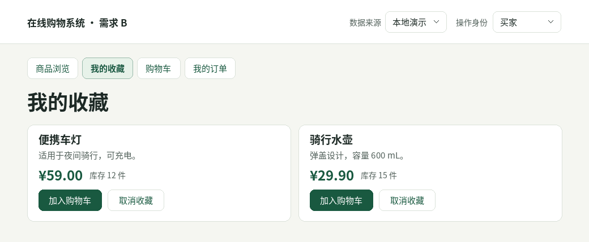
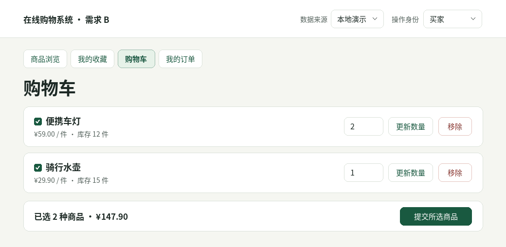
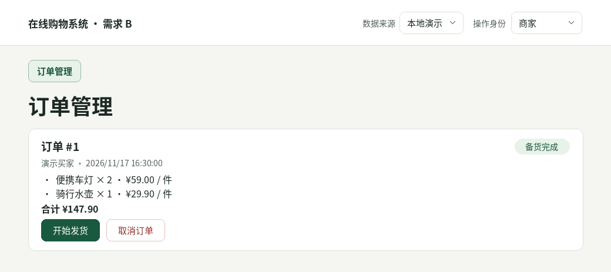

# 需求 B 前端汇报

第 10 组 · 孙俊杰 · 界面演示图使用示例数据

### 商品收藏

我新增了「我的收藏」页面。买家可以查看已收藏商品、取消收藏，也可以从收藏页直接加入购物车。

### 购物车批量下单

我新增了购物车页面。买家可以修改数量、移除商品、勾选多种商品，查看合计金额后一次提交。

### 订单管理

我新增了买家订单页和商家订单管理页。买家可查看订单明细和当前状态，商家可确认订单、标记备货完成、发货和完成交易。页面按订单状态显示可用操作，包括取消订单。

