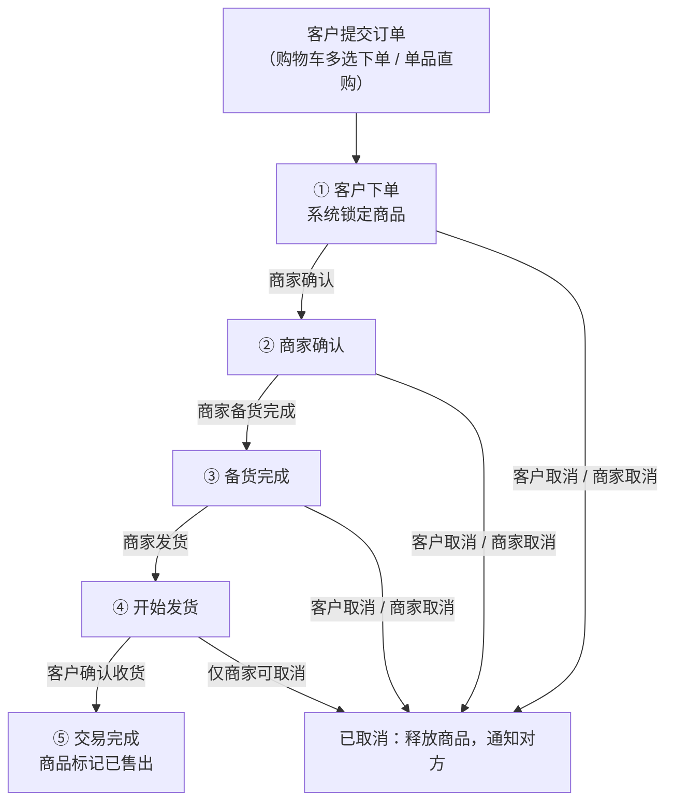
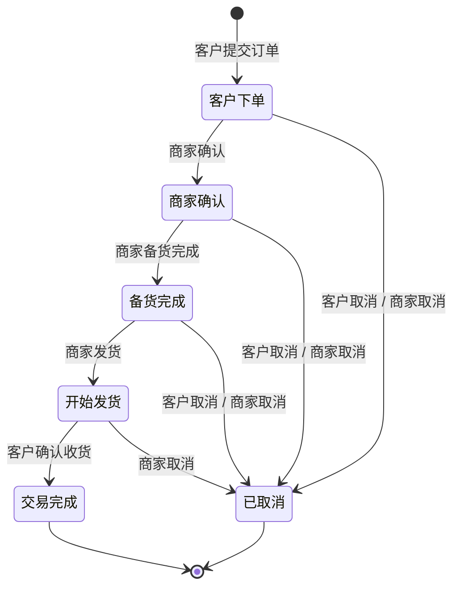

# 需求规格说明书

| 项目 | 内容 |
| --- | --- |
| 产品名称 | 在线购物 · 二手单品体验店（SECOND HAND STORE） |
| 需求范围 | 挑战需求B：B.1 订单升级、B.2 商品预选升级 |
| 编写人 | 陆峻辉（需求分析） |
| 版本 | V2.0（按挑战需求B 官方定义修订） |

---

## 1. 产品需求概述

本产品为面向个人闲置交易的二手交易平台，包含**买家端**与**卖家后台**。前期已实现商品发布、浏览搜索、收藏、意向订单与交易进度追踪。本期按挑战需求B 官方定义实施两项升级：

**B.1 订单升级**
- 系统支持订单管理，订单包括 **客户下单、商家确认、备货完成、开始发货、交易完成** 5 个状态；
- 订单处于**开始发货状态前**，客户可以取消订单；
- 订单处于**交易完成状态前**，商家可以取消订单。

**B.2 商品预选升级**
- 客户可以收藏商品；
- 客户可以选择商品进入购物车；
- 客户可以从购物车中选择**多件商品进行下单**；
- 客户可以从购物车中选择**多件商品转为收藏**。

**范围外**：在线支付网关、售后退款仲裁、物流系统对接（发货仅更新订单状态）。

## 2. 用户角色与用例

### 2.1 角色定义

| 角色 | 描述 |
| --- | --- |
| 客户（买家） | 浏览、预选并购买闲置商品的注册用户 |
| 商家（卖家） | 发布商品并处理订单的注册用户（同一账号可兼具客户身份） |

### 2.2 角色-用例对应表

| 角色 | 用例 |
| --- | --- |
| 客户 | 浏览/搜索商品、收藏商品、加入购物车、购物车多选下单、购物车多选转收藏、取消订单（开始发货前）、查看交易进度、确认收货 |
| 商家 | 发布/管理商品、处理订单（确认 → 备货完成 → 发货）、取消订单（交易完成前）、查看订单与数据看板 |

### 2.3 核心用例详情表

| 用例 | 参与者 | 前置条件 | 基本流程 | 异常 / 后置 |
| --- | --- | --- | --- | --- |
| UC-01 收藏商品 | 客户 | 已登录，商品存在 | ① 点击收藏 ② 系统记录并更新收藏数 ③ 可在收藏夹查看/取消 | 操作幂等；商品售出后收藏保留并标记失效 |
| UC-02 加入购物车 | 客户 | 已登录，商品在售 | ① 点击加购 ② 系统校验商品状态 ③ 写入购物车 | 重复加购提示已在购物车；不锁定商品；已售/下架商品加购失败 |
| UC-03 购物车多选下单 | 客户 | 已登录，购物车有勾选商品 | ① 勾选多件商品提交 ② 系统重新校验商品状态 ③ 生成订单并锁定商品，订单进入"客户下单" | 失效商品剔除并提示；商品已被他人锁定时下单失败 |
| UC-04 购物车多选转收藏 | 客户 | 已登录，购物车有勾选商品 | ① 勾选多件商品点击"转为收藏" ② 系统批量写入收藏夹 ③ 对应商品移出购物车 | 已收藏商品自动跳过，不重复计数；操作幂等 |
| UC-05 客户取消订单 | 客户 | 订单处于客户下单/商家确认/备货完成（即开始发货前） | ① 发起取消 ② 系统校验状态 ③ 订单转"已取消" ④ 释放商品并通知商家 | 开始发货及之后取消被拒绝；取消幂等 |
| UC-06 商家处理订单 | 商家 | 订单处于进行中状态 | ① 确认订单（客户下单→商家确认） ② 备货完成（→备货完成） ③ 发货（→开始发货） | 仅允许按序流转，跳变/逆流转被拒绝 |
| UC-07 商家取消订单 | 商家 | 订单处于交易完成前任一状态 | ① 发起取消并填写原因 ② 订单转"已取消" ③ 释放商品并通知客户 | 交易完成后不可取消 |
| UC-08 确认收货 | 客户 | 订单处于开始发货 | ① 客户确认收货 ② 订单转"交易完成" ③ 商品标记已售出，计入商家成交统计 | 交易完成为终态，不可再取消或变更 |

## 3. 业务流程

### 3.1 交易主流程

### 3.2 订单状态流转

**状态约束**：交易完成、已取消为终态，不可逆；五个正向状态仅允许按序流转；每次流转记录日志（操作者、时间、原因）；非法流转一律拒绝。

## 4. 关键业务规则

**购物车**
1. 二手单品数量恒为 1，重复加购不产生重复记录；
2. 加购不锁定商品，提交订单才锁定，防止一物多卖；
3. 商品售出/下架后购物车项自动标记失效，不可勾选下单；
4. 支持**多选下单**与**多选转收藏**；转收藏商品自动移出购物车，下单成功商品自动移出购物车；
5. 订单取消后商品释放恢复在售，但不自动回购物车。

**收藏**
1. 收藏/取消幂等，收藏数实时更新；
2. 失效商品保留在收藏夹并置灰，不可加购下单；
3. 收藏夹商品可加入购物车，购物车商品可批量转为收藏。

**订单取消**（与官方定义严格一致）

| 订单状态 | 客户取消 | 商家取消 |
| --- | --- | --- |
| 客户下单 | ✅ | ✅ |
| 商家确认 | ✅ | ✅ |
| 备货完成 | ✅ | ✅ |
| 开始发货 | ❌ | ✅ |
| 交易完成 / 已取消 | ❌ | ❌ |

取消公共处理：释放商品恢复在售、写状态流转日志、通知对方用户；已取消订单不可恢复，需重新下单。

## 5. 非功能需求

| 类别 | 要求 |
| --- | --- |
| 一致性 | 下单锁定与状态变更保证事务性，杜绝超卖 |
| 幂等性 | 收藏、加购、取消、状态推进等操作重复提交不产生脏数据 |
| 性能 | 列表查询 P95 < 500ms，订单状态变更实时可见 |
| 可追溯 | 订单全生命周期状态日志可查询 |

## 6. 验收标准

1. 订单按"客户下单 → 商家确认 → 备货完成 → 开始发货 → 交易完成"顺序流转，跳变与逆流转被拒绝；
2. 客户在开始发货前可取消订单，开始发货后取消被拒绝；
3. 商家在交易完成前可取消订单，交易完成后取消被拒绝；
4. 购物车支持多选下单与多选转收藏，转收藏后商品移出购物车且收藏不重复；
5. 同一商品仅能被一笔订单锁定成交，取消后商品恢复在售；
6. 收藏、取消等操作重复执行结果一致。
